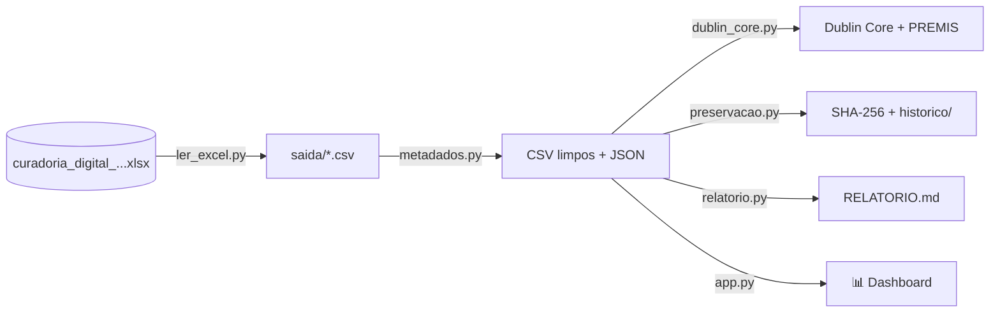

# 📚 Curadoria Digital dos Metadados — Transformação Digital Inclusiva


Pipeline de **curadoria, normalização e publicação de metadados** do projeto
**Transformação Digital Inclusiva: cidadania, acessibilidade e ensino**
(IBICT · PD&I). Lê a planilha de curadoria, normaliza os campos, gera CSV, JSON,
Excel e Dublin Core XML com PREMIS, preserva a integridade com SHA-256 e
snapshots versionados, e oferece um **dashboard acessível**.

🔗 **Dashboard online:** `https://transformacao-digital-inclusiva.streamlit.app`

## 🔄 Fluxo



## ⚡ Início rápido

```bash
git clone <url-do-repositorio> && cd transformacao-digital-inclusiva
python -m venv .venv && source .venv/bin/activate   # Windows: .venv\Scripts\activate
pip install -r requirements.txt

python ler_excel.py      # Excel → CSVs (6 abas)
python metadados.py      # normalização + URLs
python dublin_core.py    # Dublin Core XML + PREMIS
python preservacao.py    # checksums + snapshot
python relatorio.py      # saida/RELATORIO.md
streamlit run app.py     # dashboard em localhost:8501
```

Requer Python 3.10+. Se o `Makefile` tiver alvos equivalentes, use `make all`.

## 🧩 Módulos e abas

| Módulo | Função |
|---|---|
| `ler_excel.py` | Extrai as abas do `.xlsx` para CSV (`;`, UTF-8 BOM) |
| `metadados.py` | Normaliza campos, valida URLs, gera CSV/JSON limpos |
| `dublin_core.py` | Gera Dublin Core XML com eventos PREMIS |
| `preservacao.py` | SHA-256, manifesto (JSON/CSV) e snapshots em `saida/historico/` |
| `relatorio.py` | Relatório de qualidade e cobertura |
| `app.py` | Dashboard Streamlit |

**Abas de entrada:** Recursos · Vocabulário controlado · Novos termos ·
Relações · Fontes · Avaliações (→ `catalogo_recursos.csv`,
`vocabulario_controlado.csv`, `novos_termos.csv`, `relacoes.csv`, `fontes.csv`,
`avaliacoes.csv`). Valores múltiplos na mesma célula: separe com `;` ou `|`.

## 📊 Dashboard e acessibilidade

- Visão geral, busca sem acentos, filtros, gráficos com tabela alternativa,
  links clicáveis, ficha do registro e download em CSV.
- Aceita upload de `.xlsx` quando não há CSVs em `saida/`.
- Idioma `pt-BR`, texto ajustável (90–150%), **alto contraste**, redução de
  animações, foco visível para teclado e paleta Okabe-Ito (segura para
  daltonismo, sem depender só de cor).

## ☁️ Publicação no Streamlit Cloud

1. Gere os CSVs e faça commit de `app.py`, `requirements.txt`,
   `.streamlit/config.toml` e `saida/` no GitHub (use repositório privado se
   os dados forem sensíveis).
2. Em [share.streamlit.io](https://share.streamlit.io) → **Create app** →
   escolha repositório, branch e `app.py` → **Deploy**.
3. Para atualizar, gere os CSVs de novo e faça commit.

## 🛡️ Preservação e padrões

- **SHA-256** de todos os arquivos: `saida/manifest_sha256.json` e `.csv`
  (`sha256sum arquivo` para conferir).
- **Snapshots** em `saida/historico/<timestamp>/`.
- **Dublin Core + PREMIS** (`saida/dublin_core_*.xml`) para interoperabilidade
  com repositórios e OAI-PMH.

## 🩺 Problemas comuns

| Problema | Solução |
|---|---|
| "Rode primeiro: python ler_excel.py" | Execute `ler_excel.py` e `metadados.py` |
| Acentos quebrados no Excel | Importe como UTF-8, separador `;` |
| `ModuleNotFoundError` | `pip install -r requirements.txt` |
| Dashboard vazio na nuvem | Inclua `saida/` no commit ou envie o `.xlsx` na barra lateral |

## 🗺️ Próximos passos

SKOS/RDF · OAI-PMH · testes e CI (GitHub Actions) · validação do XML ·
grafo de relações · versão em inglês.

## 🤝 Contribuição, citação e licença

Contribua via *fork* → branch → *Pull Request*, ou abra uma *issue*.
Citação: IBICT. *Curadoria de Metadados — Transformação Digital Inclusiva*.
Brasília, 2026. 